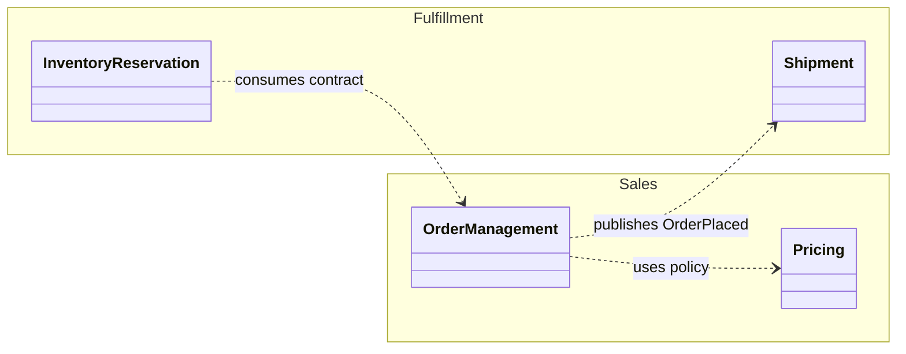
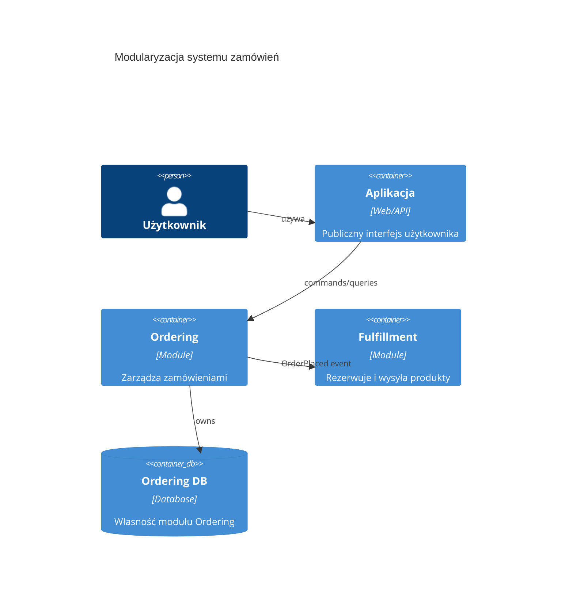

# Modularyzacja Wysokopoziomowa

Szczegóły projektowania modułów na poziomie systemu: diagram UML Package, C4 Container, macierz odpowiedzialności i publiczne API modułu.

## Spis Treści

- [Workflow](#workflow)
- [UML Package](#uml-package)
- [C4 Container](#c4-container)
- [Macierz Odpowiedzialności](#macierz-odpowiedzialności)
- [Publiczne API Modułu](#publiczne-api-modułu)
- [Reguły Zależności](#reguły-zależności)

## Workflow

1. Nazwij zdolności biznesowe i przypisz je do subdomen.
2. Zgrupuj zdolności w bounded contexts, nie w warstwy techniczne.
3. Określ kierunki zależności: kto publikuje kontrakt, kto konsumuje, gdzie potrzebny jest ACL.
4. Zdefiniuj publiczne API modułów zanim opiszesz katalogi, klasy albo adaptery.
5. Narysuj UML Package dla zależności modułów i C4 Container, gdy podział wpływa na runtime lub integracje.
6. Zapisz decyzje w `domain.md` albo w planie modułów, jeśli dokument domenowy nie jest wynikiem zadania.

## UML Package

UML Package pokazuje moduły i kierunki zależności. Użyj Mermaid, gdy wynik ma trafić do Markdown.

Dobre diagramy wysokopoziomowe:

- pokazują moduły domenowe, nie każdy folder i klasę;
- mają jawny kierunek zależności;
- oznaczają typ integracji, jeśli ma znaczenie: direct call, event, query, ACL;
- nie maskują cykli przez brak strzałek;
- używają nazw z ubiquitous language.

## C4 Container

C4 Container dodaj, gdy granice modułów wpływają na procesy, aplikacje, bazy danych, kolejki, gatewaye lub deployment.

Nie twórz C4 tylko dla ozdoby. Jeśli system pozostaje jednym deployable monolitem, C4 może opisywać modularny monolit, wspólne runtime i oddzielne ownership boundaries.

## Macierz Odpowiedzialności

Macierz ma ujawnić overlap, luki i publiczne zdolności modułów.

| Moduł | Zdolności biznesowe | Dane właścicielskie | Publikuje | Konsumuje | Decyzje właściciela |
| --- | --- | --- | --- | --- | --- |
| Ordering | Przyjęcie zamówienia, lifecycle zamówienia | Orders, OrderLines | OrderPlaced, OrderCancelled | PriceCalculated | Statusy i invarianty zamówień |
| Pricing | Cenniki, rabaty, polityki cenowe | PriceList, DiscountPolicy | PriceCalculated | CustomerSegmentChanged | Reguły cen i promocji |
| Fulfillment | Rezerwacja, wysyłka | Reservations, Shipments | ShipmentCreated | OrderPlaced | Reguły realizacji |

Sygnały problemu:

- dwa moduły deklarują tę samą decyzję biznesową;
- moduł publikuje event, którego znaczenia nie posiada;
- dane są zapisywane przez wiele modułów bez jednego właściciela;
- zdolność biznesowa nie ma właściciela albo ma tylko warstwę techniczną.

## Publiczne API Modułu

Granica modułu jest kontraktem, nie katalogiem. Dla każdego modułu zapisz:

| Element | Pytanie | Przykład |
| --- | --- | --- |
| Commands | Jakie intencje przyjmuje moduł? | `PlaceOrder`, `CancelOrder` |
| Queries | Jakie odczyty są publiczne? | `GetOrderStatus` |
| Events | Co moduł publikuje po zmianie faktu domenowego? | `OrderPlaced` |
| Policies | Jakie reguły są konfigurowalne lub udostępnione? | `DiscountEligibilityPolicy` |
| Data ownership | Co moduł zapisuje jako source of truth? | `Order`, `OrderLine` |
| Integration strategy | Jak inny moduł ma się integrować? | ACL, event, OHS+PL, shared kernel |

Publiczne API powinno być mniejsze niż wewnętrzny model. Nie eksportuj encji tylko po to, aby inny moduł mógł ominąć kontrakt.

## Reguły Zależności

- Zależności prowadź do kontraktów lub portów, nie do wewnętrznych typów modułu.
- Shared kernel dopuszczaj tylko dla małego, stabilnego i wspólnie zarządzanego modelu.
- Direct reference jest akceptowalne w modularnym monolicie, jeśli przechodzi przez publiczne API modułu.
- Eventy są dobre dla faktów domenowych i autonomii, ale nie zastępują modelowania własności danych.
- Anti-Corruption Layer stosuj, gdy model zewnętrzny lub legacy nie powinien przeciekać do core.
